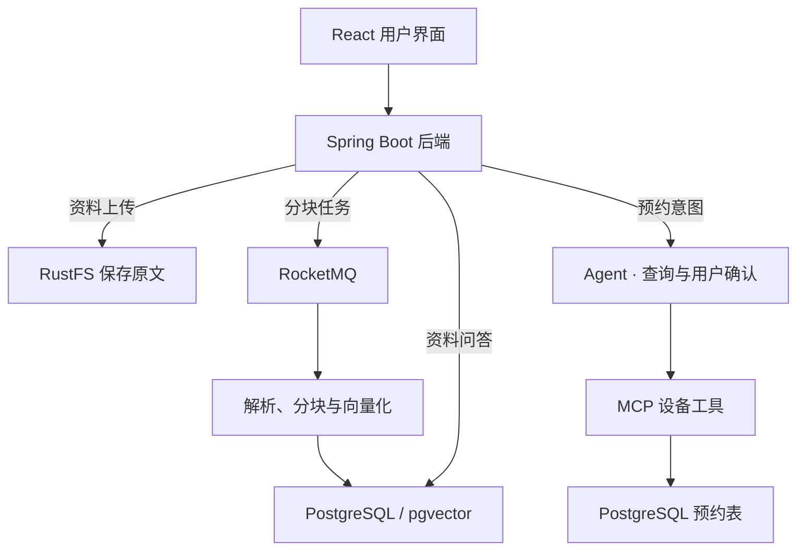

<!-- LabDesk project documentation. -->
# LabDesk｜实验室资料问答与设备预约

LabDesk 用于查询校内实验室资料和预约设备。登录后可以查阅操作规程和安全须知，从答案打开引用的原文，也可以查看设备空闲时段、确认预约并查询自己的预约记录。

[使用流程](#使用流程) · [本机启动](#本机启动) · [请求如何流转](#请求如何流转) · [验证结果](#验证结果)

| 在哪里 | 可以做什么 |
| --- | --- |
| **资料问答** | 根据实验室文档回答问题，流式显示结果，点击来源查看原文。 |
| **实验室助手** | 查询设备空闲时段，核对预约确认卡，查看个人预约编号。 |
| **管理后台** | 上传资料、检查分块状态、管理成员和查看操作记录。 |

## 使用流程

1. 管理员上传实验室资料，等待文档完成分块和向量入库。项目附有[设备操作规程、安全须知和预约规则](resources/labdesk-demo)三份虚构样例。
2. 进入「资料问答」，试问“教学显微镜用完后要贴什么颜色的复位卡？”。回答会逐步显示，可以点开来源核对原文。
3. 进入「实验室助手」，查询指定日期和设备的空闲时段。选择一个时段后，在确认卡上核对设备、日期和时间。预约成功后可在同一入口查询预约编号。

预约按北京时间处理，每段一小时，起始时间为 `09:00` 到 `17:00` 的整点。用样例演示时可以查询教学显微镜 `SCOPE-01`、电子测量台 `BENCH-02` 或桌面 3D 打印机 `PRINT-03`。

[完整演示与验收步骤](docs/labdesk-demo.md)

## 本机启动

Windows 环境需要 JDK 17、Node.js 22.12 或更新版本、Maven 和 Docker Desktop。首次下载只取 `main` 分支的最新提交。

```powershell
git clone --depth 1 --single-branch --branch main https://github.com/QYL66/labdesk.git
cd labdesk
mvn.cmd -DskipTests package
Push-Location frontend
npm.cmd ci
Pop-Location
```

1. 启动 Docker Desktop，确认本机已有 `pgvector/pgvector:pg16`、`redis:8.4-alpine`、`rustfs/rustfs:1.0.0-alpha.72` 和 `apache/rocketmq:5.2.0`。中间件的本地凭据由启动脚本生成。
2. 双击 [启动 LabDesk](local/Start-LabDesk.cmd)。首次启动时设置至少 12 个字符的管理员密码，然后在窗口按提示输入 DeepSeek 和阿里云百炼 Key。
3. 用 `admin` 登录 [本机 LabDesk](http://127.0.0.1:15173/)，再双击 [导入演示资料](local/Import-LabDeskDemo.cmd)。脚本创建 `LabDeskDemo` 知识库，导入样例并检查分块状态。
4. 双击 [停止 LabDesk](local/Stop-LabDesk.cmd)。下次启动继续使用原有数据卷。

前端监听 `15173`，Java 后端监听 `9090`，MCP 监听 `9099`。Compose 中间件端口为 PostgreSQL `5432`、Redis `16379`、RustFS `9000/9001` 和 RocketMQ `19876/10909/10911`，均绑定本机。Windows 脚本优先使用 PATH 上的 Docker CLI，可用 `LABDESK_DOCKER_EXE` 指定其他位置。用 IntelliJ IDEA 打开项目时，导入根目录的 [pom.xml](pom.xml) 即可。

## 请求如何流转



- **资料入库**。后端把原始文档存入 RustFS，经 RocketMQ 投递分块任务。消费者解析文档、计算向量，再写入 PostgreSQL/pgvector。
- **资料问答**。后端检索相关片段，用 SSE 推送答案并返回来源。前端用来源信息打开文档预览。
- **设备预约**。Agent 通过 MCP 查空闲、提交预约和查询个人记录。提交前需要确认，工具从服务端会话取得用户身份。PostgreSQL 用设备和起始时间的唯一约束裁决并发。同一账户重复提交同一预约时返回原编号，其他账户提交相同时段会收到已占用提示。

| 预约工具 | 操作 |
| --- | --- |
| `lab_list_availability` | 按日期查询空闲时段，可指定设备。 |
| `lab_book_equipment` | 确认后为当前用户预约一个整点时段。 |
| `lab_list_my_bookings` | 查询当前用户的预约记录。 |

[源码导读与断点位置](docs/labdesk-guide.md)

## 运行数据

数据库和对象存储使用独立的 `labdesk-local` Compose 数据卷。管理员密码以加盐哈希保存，模型 Key 在启动时通过进程环境传给后端。连接云模型时，提问和检索到的资料片段会发送给模型服务。演示请使用随附的虚构资料。本地配置、日志和数据文件留在本机。

## 验证结果

| 检查项 | 结果 |
| --- | --- |
| 构建与回归 | 前后端构建通过。94 项后端测试、31 项前端测试通过，覆盖 MCP 目录和身份传递、预约参数校验、确认事件和会话回放。 |
| 依赖审计 | 2026-11-14 的 npm 审计和对可执行 JAR 依赖的 OSV 查询均无匹配告警。 |
| 本机联调 | 资料入库、在线问答、预约抢占和重启保留需在运行后验收。 |

## 开源许可

[Apache-2.0](LICENSE)
